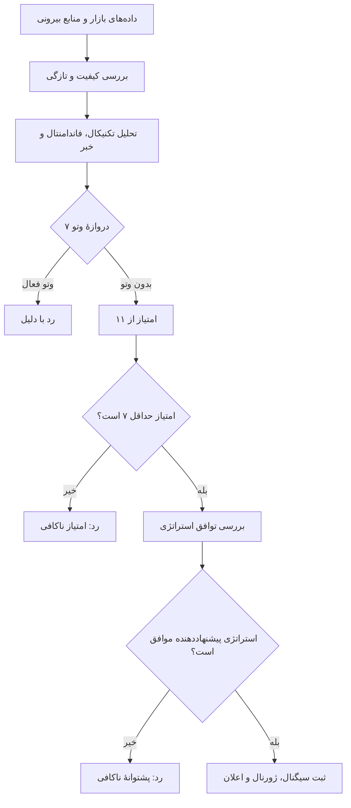
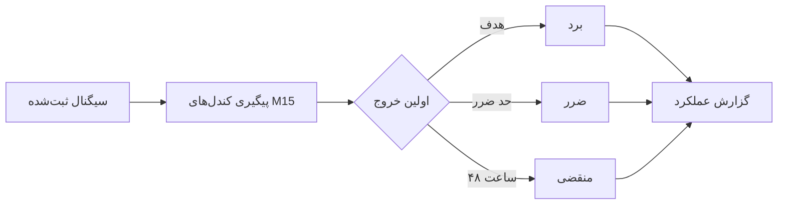
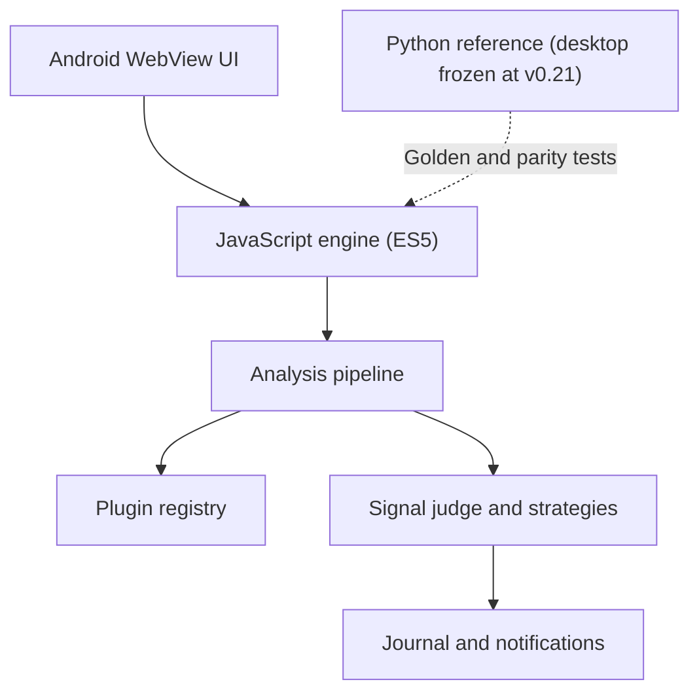

<div align="center">


# ODIN Assistant

### دستیار هوشمند تحلیل فارکس و طلا برای اندروید

تحلیل بازار با منبع قیمت/کندل Twelve Data، ارزیابی شواهد و ارائهٔ سیگنال‌های قابل‌ردیابی؛
**تصمیم نهایی همیشه با کاربر است.**

تحلیل تکنیکال · فاندامنتال · اخبار اقتصادی · تأییدیهٔ TradingView · ژورنال عملکرد

[](CHANGELOG.md)
[](https://github.com/Suushian/Odin-Assistant/releases/latest)
[](https://github.com/Suushian/Odin-Assistant/actions/workflows/build-android.yml)
[](https://github.com/Suushian/Odin-Assistant/actions/workflows/build-release.yml)

[**دریافت آخرین APK**](https://github.com/Suushian/Odin-Assistant/releases/latest) · [تاریخچهٔ نسخه‌ها](CHANGELOG.md) · [تلگرام رسمی](https://t.me/Khode_Sushian)

</div>
---

> **نکتهٔ مهم:** ODIN ربات معامله‌گر نیست. به بروکر وصل نمی‌شود و معاملهٔ خودکار انجام نمی‌دهد. برنامه داده‌ها را تحلیل می‌کند، دلیل صدور یا رد سیگنال را نمایش می‌دهد و تصمیم را به کاربر می‌سپارد. هیچ سود یا نرخ بردی تضمین نمی‌شود.

## نمای کلی

ODIN برای تحلیل هفت جفت‌ارز اصلی و طلا طراحی شده است. موتور اندروید، داده‌های بازار و شواهد تحلیلی را بررسی می‌کند و تنها در صورت عبور از کنترل‌های کیفیت، امتیازدهی و توافق استراتژی، سیگنال پیشنهاد می‌دهد.

- **۴ منظر تحلیلی:** تکنیکال، فاندامنتال، خبر و تأییدیهٔ TradingView
- **۷ دروازهٔ وتو:** مستقل از امتیاز نهایی
- **۱۱ امتیاز ممکن:** آستانهٔ پیش‌فرض صدور سیگنال ۷
- **چرخهٔ پیش‌فرض تحلیل:** هر ۱۵ دقیقه، قابل تنظیم
- **حداکثر ۳ سیگنال در هر چرخه**
- **بدون سرور اختصاصی پروژه:** دریافت داده از منابع بیرونی انجام می‌شود؛ بنابراین دسترس‌پذیری آن منابع تضمین‌شده نیست.

## مسیر صدور سیگنال



### دروازه‌های وتو

- دادهٔ ناکافی یا نامعتبر
- بسته‌بودن بازار
- تضاد تایم‌فریم‌ها
- نبود روند مناسب
- رویداد پراثر اقتصادی
- جهش غیرعادی نوسان
- خبر فوری

### امتیازدهی

امتیاز از شواهد موجود محاسبه می‌شود: هم‌راستایی روند، واکنش به سطح کلیدی، فاندامنتال، مومنتوم RSI، قدرت ارزها، خبر، تأییدیهٔ TradingView و سشن نقدشونده. **دادهٔ غایب امتیاز مثبت نمی‌گیرد** و جایگزین دادهٔ معتبر نمی‌شود.

## استراتژی‌ها

**روند + پولبک — پیشنهاددهنده**

- هم‌جهتی روند H4 و H1
- ADX حداقل ۲۰
- پولبک RSI و تأیید ادامهٔ حرکت

**شکست لندن — پیشنهاددهنده**

- شکست محدودهٔ آسیا در پنجرهٔ زمانی مشخص
- فیلتر ATR برای ارزیابی اندازهٔ محدوده و نفوذ شکست

**کری (نرخ بهره) — فقط تأییدکننده**

- بررسی اختلاف نرخ سیاستی، قدرت نسبی ارزها و اخبار
- به‌تنهایی هرگز سیگنال صادر نمی‌کند

سیگنال تنها وقتی صادر می‌شود که دست‌کم یک استراتژی پیشنهاددهنده موافق باشد و حداقل توافق تنظیم‌شده تأمین شود. اگر همهٔ استراتژی‌های پیشنهاددهنده غیرفعال باشند، سیستم عمداً سیگنال صادر نمی‌کند.

جزئیات پارامترها در [بستهٔ زمینهٔ توسعه](docs/ODIN-AI-Context-Pack-fa.md) و [معماری پلاگین‌ها](docs/plugin-architecture-fa.md) نگهداری می‌شوند.

## منابع داده

- **Twelve Data** تنها منبع قیمت و کندل بازار در موتور اندروید و مسیر مرجع پایتون است؛ هر کاربر باید کلید API اختصاصی خود را وارد کند. برای هر نماد یک درخواست M15 انجام می‌شود و H1/H4 از همان داده ساخته می‌شوند.
- **TradingView** صرفاً تأییدیهٔ تکنیکال جداگانه است و منبع جایگزین قیمت/کندل نیست.
- **ForexFactory** برای تقویم اقتصادی و **RSS** برای اخبار استفاده می‌شوند؛ این‌ها منابع قیمت/کندل بازار محسوب نمی‌شوند.

اگر Twelve Data در دسترس نباشد یا دادهٔ کافی و معتبر فراهم نشود، تحلیل آن نماد رد می‌شود؛ هیچ منبع قیمت جایگزین یا مسیر fallback فعال نیست.

## ژورنال و کارنامه

- هر سیگنال در ژورنال ثبت و نتیجهٔ آن بر اساس کندل‌های M15 پیگیری می‌شود.
- نتیجه با رسیدن به هدف، حد ضرر یا انقضای ۴۸ ساعته تعیین می‌شود.
- اگر یک کندل هم هدف و هم حد ضرر را لمس کند، نتیجه به‌صورت محتاطانه «ضرر» ثبت می‌شود.
- کارنامهٔ هفتگی نرخ برد و میانگین R را گزارش می‌کند و می‌تواند نتیجه‌ها را بر اساس نماد، جهت، امتیاز، استراتژی و شواهد تفکیک کند.



> کارنامه عملکرد گذشته را توصیف می‌کند و پیش‌بینی یا تضمین نتیجهٔ آینده نیست.

## قابلیت‌های برنامه

- تحلیل روند، مومنتوم، حمایت و مقاومت و قدرت نسبی ارزها
- اعلان سیگنال، خبر فوری، هشدار قیمت و وضعیت سرویس
- رصد پس‌زمینه با فاصلهٔ زمانی قابل تنظیم
- نمودارهای H1/H4، نمایش سطوح کلیدی و کارت تصویری سیگنال
- رابط فارسی با تاریخ جلالی و ساعت تهران
- وضعیت پلاگین‌ها و خطاهای ثبت‌شده برای عیب‌یابی
- لایسنس متصل به کد دستگاه و تریال ۷ روزه

## نصب

1. آخرین APK را از [صفحهٔ Releases](https://github.com/Suushian/Odin-Assistant/releases/latest) دریافت کنید.
2. روی Android 7.0 یا جدیدتر نصب کنید.
3. در صورت نیاز، مجوز نصب از منابع ناشناس را در تنظیمات سیستم فعال کنید.
4. برای رصد پس‌زمینه، اعلان‌ها را مجاز کنید. اگر سرویس متوقف شد، محدودیت باتری و تنظیمات اختصاصی سازندهٔ گوشی را بررسی کنید.
5. برای فعال‌سازی یا پرسش دربارهٔ لایسنس، [کانال رسمی](https://t.me/Khode_Sushian) را ببینید.

جزئیات فعال‌سازی و محدودیت‌ها در [راهنمای لایسنس](LICENSE_GUIDE.md) آمده است.

## معماری



- **پلتفرم فعال:** اپ اندروید با رابط WebView و JavaScript سازگار با ES5
- **معماری پلاگین‌محور:** قابلیت‌ها از طریق قراردادها، مانیفست و registry مدیریت می‌شوند.
- **جداسازی خطا:** خطای پلاگین باید قابل مشاهده باشد و نباید با دادهٔ ساختگی پنهان شود.
- **مرجع پایتون:** نسخهٔ دسکتاپ از v0.21 منجمد است و برای تست‌های مرجع و parity استفاده می‌شود.
- **نسخه‌دهی:** نسخهٔ برنامه از `src/app_paths.py::APP_VERSION` خوانده می‌شود.

### اجرای تست‌ها

```bash
python main.py --selftest
python tests/check_config.py
for t in tests/test_*.py; do python "$t"; done
for s in tests/js/smoke_*.js tests/js/test_*.js; do node "$s"; done
```

تست‌های parity زنده و سرویس پس‌زمینه ممکن است به اینترنت یا دستگاه واقعی نیاز داشته باشند و در همهٔ اجراهای CI پوشش داده نمی‌شوند.

## تغییرات اخیر

- هویت بصری لانچر به حباب گفت‌وگوی آبی با دو خط سفید و پس‌زمینهٔ تیره تغییر کرده است؛ منبع برداری و پیش‌نمایش SVG در `docs/odin-launcher-icon.svg` نگهداری می‌شود.

بر اساس نسخهٔ موجود در `main` و تغییرات ثبت‌شده در تاریخچه:

- متن‌های راهنمای غیرضروری از صفحات رابط اندروید حذف شدند؛ کنترل‌ها و هشدارهای عملیاتی حفظ شده‌اند.
- گزارش ژورنال برای گروه‌بندی هفتگی و ارزیابی اولین کندل خروج اصلاح شد.
- گارد انتشار اندروید برای بررسی تگ انتشار سخت‌گیرانه‌تر شده است.
- نسخهٔ فعلی مستندات: **1.0.0**. تاریخچهٔ دقیق در [CHANGELOG.md](CHANGELOG.md) قرار دارد.

## محدودیت‌های شناخته‌شده

- هیچ سیستم معاملاتی سود را تضمین نمی‌کند؛ این برنامه ابزار تحلیل است، نه مشاورهٔ مالی.
- منابع دادهٔ بیرونی ممکن است کند، قطع یا تغییر کنند.
- جدول نرخ‌های سیاستی استراتژی کری نیاز به به‌روزرسانی دارد؛ کری به‌تنهایی سیگنال نمی‌سازد.
- در این README ادعایی دربارهٔ بک‌تست معتبر یا سودآوری اثبات‌شده مطرح نمی‌شود.
- تست خودکار جایگزین بررسی رصد پس‌زمینه روی دستگاه‌ها و نسخه‌های واقعی Android/OEM نیست.
- اسکرین‌شات واقعی از اپ اندروید هنوز در مستندات ثبت نشده است.

## پیوندهای توسعه

- [بستهٔ زمینهٔ توسعه](docs/ODIN-AI-Context-Pack-fa.md)
- [معماری پلاگین‌ها](docs/plugin-architecture-fa.md)
- [راهنمای اندروید](docs/android-fa.md)
- [راهنمای لایسنس](LICENSE_GUIDE.md)
- [تغییرات نسخه‌ها](CHANGELOG.md)

---

**سازنده:** Sushian Khoshkhani · **مدیریت پروژه:** Reza Khoshkhani · **اسپانسر:** Karen Khoshkhani

© 2026 Sushian Khoshkhani — All rights reserved.

[دریافت APK](https://github.com/Suushian/Odin-Assistant/releases/latest) · [تلگرام رسمی](https://t.me/Khode_Sushian)

*این ابزار آموزشی و تحلیلی است. معامله در فارکس پرریسک است؛ مسئولیت هر تصمیم معاملاتی با کاربر است.*
