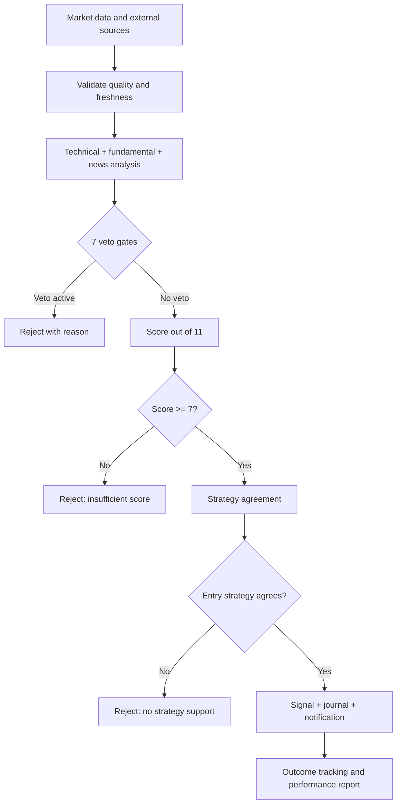
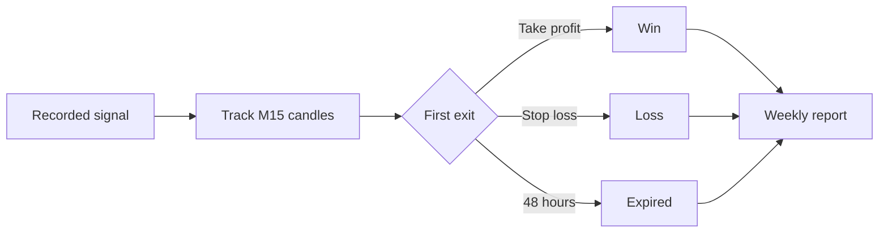
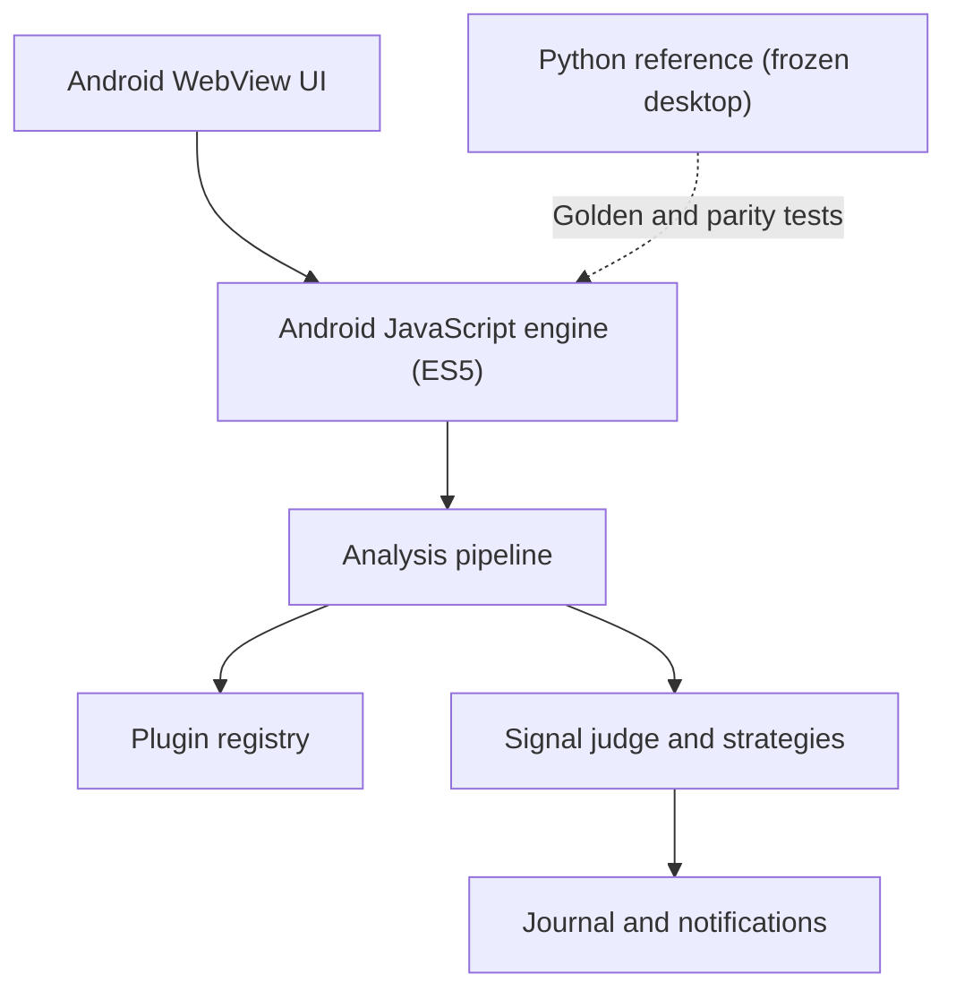

<div dir="ltr" align="left">

<h1 dir="ltr" align="left">ODIN Assistant</h1>
</div>

<h2 dir="rtl" align="right">دستیار تحلیل فارکس و طلا برای اندروید</h2>
<p dir="rtl" align="right">تحلیل چندمنبعی · سیگنال مستدل · کارنامهٔ شفاف</p>

<div align="center" dir="ltr">

[](CHANGELOG.md)
[](https://github.com/Suushian/Odin-Assistant/releases/latest)
[](https://github.com/Suushian/Odin-Assistant/actions/workflows/build-android.yml)
[](https://github.com/Suushian/Odin-Assistant/actions/workflows/build-release.yml)


[](https://github.com/Suushian/Odin-Assistant/releases/latest)
[](CHANGELOG.md)
[](https://t.me/Khode_Sushian)

</div>

---

<div dir="rtl" align="right">

> [!IMPORTANT]
> **ODIN ربات معامله‌گر نیست.** به بروکر وصل نمی‌شود و معاملهٔ خودکار انجام نمی‌دهد؛ داده‌ها را تحلیل می‌کند، دلیل صدور یا رد سیگنال را نشان می‌دهد و تصمیم نهایی را به کاربر می‌سپارد. هیچ سود یا نرخ بردی تضمین نمی‌شود.

</div>


<div dir="rtl" align="right">

<h2 dir="rtl" align="right">نمای کلی</h2>

<table dir="rtl" align="right">
<tr>
<td align="right" width="25%"><h3>4</h3><sub>منظر تحلیلی</sub><br>تکنیکال، فاندامنتال، خبر، <span dir="ltr">TradingView</span></td>
<td align="right" width="25%"><h3>7</h3><sub>دروازهٔ وتو</sub><br>مستقل از امتیاز</td>
<td align="right" width="25%"><h3>11</h3><sub>حداکثر امتیاز</sub><br>آستانهٔ پیش‌فرض: 7</td>
<td align="right" width="25%"><h3>15 دقیقه</h3><sub>چرخهٔ پیش‌فرض</sub><br>قابل تنظیم</td>
</tr>
</table>

</div>

<div dir="rtl" align="right">

<h2 dir="rtl" align="right">مسیر تحلیل در یک نگاه</h2>

<div dir="ltr" align="left">



</div>

</div>

<div dir="rtl" align="right">

<h2 dir="rtl" align="right">قابلیت‌ها</h2>

<table dir="rtl" align="right">
<thead><tr><th align="right">حوزه</th><th align="right">آنچه در برنامه وجود دارد</th></tr></thead>
<tbody>
<tr><td align="right"><strong>تحلیل بازار</strong></td><td align="right">روند و مومنتوم در <span dir="ltr">H4/H1</span>، کندل‌های <span dir="ltr">M15</span> برای پیگیری نتیجه، سطوح حمایت/مقاومت و قدرت نسبی ارزها</td></tr>
<tr><td align="right"><strong>داور سیگنال</strong></td><td align="right">۷ وتوی مستقل، ۸ شاهد با مجموع ۱۱ امتیاز، آستانهٔ پیش‌فرض ۷ و سقف ۳ سیگنال در هر چرخه</td></tr>
<tr><td align="right"><strong>استراتژی‌ها</strong></td><td align="right">روند + پولبک، شکست لندن و کری؛ کری فقط تأییدکننده است و به‌تنهایی سیگنال نمی‌سازد</td></tr>
<tr><td align="right"><strong>رصد پس‌زمینه</strong></td><td align="right">تحلیل دوره‌ای، اعلان سیگنال، خبر فوری، هشدار قیمت و اعلان وضعیت سرویس</td></tr>
<tr><td align="right"><strong>ژورنال و کارنامه</strong></td><td align="right">ثبت <code dir="ltr">append-only</code>، ارزیابی خودکار نتیجه، نرخ برد و میانگین <code dir="ltr">R</code> هفتگی با تفکیک استراتژی و مدرک</td></tr>
<tr><td align="right"><strong>نمودار و اشتراک</strong></td><td align="right">نمودار <span dir="ltr">H1/H4</span>، سطوح کلیدی، نمایش سیگنال و کارت تصویری با تاریخ جلالی و ساعت تهران</td></tr>
<tr><td align="right"><strong>رابط فارسی</strong></td><td align="right">ارقام فارسی، تقویم جلالی، ساعت تهران، آیکون‌های <span dir="ltr">SVG</span> و تم <span dir="ltr">Aurora Glass 2.0</span></td></tr>
<tr><td align="right"><strong>کیفیت شواهد</strong></td><td align="right">دادهٔ ناموجود امتیاز مثبت نمی‌گیرد؛ شواهد غایب نباید به‌جای تأیید استفاده شوند</td></tr>
<tr><td align="right"><strong>کنترل پلاگین‌ها</strong></td><td align="right">نمایش وضعیت پلاگین‌ها و خطاهای ثبت‌شده برای عیب‌یابی</td></tr>
<tr><td align="right"><strong>لایسنس</strong></td><td align="right">تریال ۷ روزه، لایسنس متصل به کد دستگاه و کنترل دستکاری ساعت</td></tr>
</tbody>
</table>

</div>

<div dir="rtl" align="right">

<h2 dir="rtl" align="right">استراتژی‌ها و دروازهٔ توافق</h2>

<table dir="rtl" align="right">
<thead><tr><th align="right">روند + پولبک</th><th align="right">شکست لندن</th><th align="right">کری</th></tr></thead>
<tbody>
<tr><td align="right">روند <span dir="ltr">H4/H1</span>، <span dir="ltr">ADX</span> و برگشت <span dir="ltr">RSI</span></td><td align="right">شکست محدودهٔ آسیا با فیلتر <span dir="ltr">ATR</span></td><td align="right">اختلاف نرخ بهره، قدرت ارز و اخبار</td></tr>
<tr><td align="right"><strong>پیشنهاددهنده</strong></td><td align="right"><strong>پیشنهاددهنده</strong></td><td align="right"><strong>فقط تأیید</strong></td></tr>
</tbody>
</table>

سیگنال باید از داور امتیازدهی عبور کند و پشتوانهٔ استراتژی داشته باشد. استراتژی‌ها از تنظیمات قابل فعال/غیرفعال شدن‌اند؛ اگر هیچ استراتژی پیشنهاددهنده‌ای موافق نباشد، سیگنال صادر نمی‌شود.

<details>
<summary><strong>جزئیات فنی استراتژی‌ها و امتیازدهی</strong></summary>

- **روند + پولبک:** هم‌جهتی روند H4 و H1، ADX حداقل ۲۰، پولبک RSI در محدودهٔ ۳۰–۴۵ برای خرید یا ۵۵–۷۰ برای فروش و تأیید ادامهٔ حرکت.
- **شکست لندن:** محدودهٔ آسیا از ۰۰ تا ۰۷ UTC؛ پنجرهٔ بررسی شکست ۰۷ تا ۱۱ UTC؛ حاشیهٔ نفوذ ۰٫۱۵×ATR و عرض محدوده بین ۰٫۵ تا ۳×ATR.
- **کری:** اختلاف نرخ سیاستی با رتبهٔ قدرت ارزها و اخبار؛ فقط رأی موافق می‌دهد.
- **وتوها:** دادهٔ ناکافی، بازار بسته، تضاد تایم‌فریم، بازار بی‌روند، رویداد پراثر، جهش غیرعادی نوسان و خبر فوری.
- **شاهدها:** هم‌راستایی روند (۲)، سطح کلیدی (۲)، فاندامنتال (۲)، RSI (۱)، قدرت ارزها (۱)، خبر (۱)، TradingView (۱) و سشن نقدشونده (۱).
- **دادهٔ ناموجود امتیاز صفر می‌گیرد.** امتیازدهی جایگزین دادهٔ معتبر نمی‌شود.

</details>

</div>

<div dir="rtl" align="right">

<h2 dir="rtl" align="right">منابع داده</h2>

<table dir="rtl" align="right">
<thead><tr><th align="right">منبع</th><th align="right">کاربرد</th></tr></thead>
<tbody>
<tr><td align="left"><span dir="ltr">Yahoo Finance</span></td><td align="right">قیمت و کندل؛ منبع پیش‌فرض</td></tr>
<tr><td align="left"><span dir="ltr">Twelve Data</span></td><td align="right">منبع جایگزین اختیاری؛ برای استفاده به کلید نیاز دارد</td></tr>
<tr><td align="left"><span dir="ltr">ForexFactory</span></td><td align="right">تقویم اقتصادی</td></tr>
<tr><td align="left"><span dir="ltr">RSS</span></td><td align="right">خبرهای فارکس و اقتصاد</td></tr>
<tr><td align="left"><span dir="ltr">TradingView</span></td><td align="right">تأییدیهٔ تکنیکال از API غیررسمی</td></tr>
</tbody>
</table>

منابع عمومی به معنی تضمین دسترس‌پذیری نیستند. در صورت دادهٔ ناقص یا منبع ناموفق، تحلیل باید محدود یا رد شود. برنامه سرور اختصاصی پروژه ندارد؛ برای دریافت داده با منابع بیرونی ارتباط برقرار می‌کند.

</div>

<div dir="rtl" align="right">

<h2 dir="rtl" align="right">ژورنال: از سیگنال تا نتیجه</h2>

<div dir="ltr" align="left">



</div>

- نتیجه بر اساس هدف، حد ضرر یا انقضای ۴۸ ساعته ارزیابی می‌شود.
- اگر یک کندل هم هدف و هم حد ضرر را لمس کند، محاسبه محتاطانه است و نتیجه «ضرر» شمرده می‌شود.
- آمار هفتگی شامل نرخ برد، میانگین R و مقایسهٔ هفته‌ها با تفکیک نماد، جهت، امتیاز، استراتژی و مدرک است.
- اصلاحات اخیر ژورنال، دسته‌بندی هفتگی را بر اساس زمان بسته‌شدن نتیجه هماهنگ کرده و منطق گزارش اولین کندل خروج را در اندروید با موتور مرجع هم‌راستا کرده‌اند.

> **کارنامه، گذشته را توصیف می‌کند؛ پیش‌بینی یا تضمین عملکرد آینده نیست.**

</div>

<div dir="rtl" align="right">

<h2 dir="rtl" align="right">تازه‌ترین تغییرات</h2>

**نسخهٔ برنامه: 1.0.0** — جزئیات نسخه‌ها در [CHANGELOG.md](CHANGELOG.md) نگهداری می‌شود.

- **رابط اندروید خلوت‌تر شد:** متن‌های توضیحی غیرضروری از صفحه‌ها حذف شدند؛ کنترل‌های قابل‌استفاده، داده‌های زنده و هشدارهای عملیاتی حفظ شده‌اند.
- **گزارش ژورنال دقیق‌تر شد:** برچسب‌های هفته و گروه‌بندی نتیجه‌ها هم‌راستا شدند و گزارش برخورد هم‌زمان با هدف/حد ضرر فقط به اولین کندل خروج مرتبط است.
- **گارد انتشار Android سخت‌گیرانه‌تر شد:** بررسی دسترسی‌پذیری تگ پیش از انتشار محافظه‌کارانه‌تر شده است.
- **برند نسخهٔ ۱.۰:** نام نمایشی اندروید «Odin Assistant» و نام ناشر «Sushian» است.

</div>

<div dir="rtl" align="right">

<h2 dir="rtl" align="right">نصب</h2>

1. آخرین APK را از [صفحهٔ Releases](https://github.com/Suushian/Odin-Assistant/releases/latest) دریافت کنید.
2. روی **Android 7.0 یا جدیدتر** نصب کنید.
3. در صورت نیاز، اجازهٔ نصب از منابع ناشناس را در تنظیمات سیستم فعال کنید.
4. برای رصد پس‌زمینه، اعلان‌ها را مجاز کنید و در صورت توقف سرویس، محدودیت باتری/Doze سازندهٔ گوشی را بررسی کنید.
5. برای فعال‌سازی از تریال ۷ روزه استفاده کنید یا از طریق [کانال رسمی](https://t.me/Khode_Sushian) پیگیری کنید.

<details>
<summary><strong>لایسنس و حریم خصوصی</strong></summary>

- لایسنس به کد دستگاه متصل است و به‌طور معمول به دستگاه دیگر قابل انتقال نیست.
- قالب‌های مستندشده شامل کلید دائمی ۱۹ نویسه‌ای و کلید زمان‌دار ۲۶ نویسه‌ای هستند.
- برای جزئیات، محدودیت‌ها و راهنمای فعال‌سازی، [راهنمای لایسنس](LICENSE_GUIDE.md) را ببینید.
- برنامه به سرویس‌های بیرونی داده وصل می‌شود؛ ادعای «کاملاً آفلاین» صحیح نیست. سرور اختصاصی پروژه برای دریافت داده وجود ندارد.

</details>

</div>

<div dir="rtl" align="right">

<h2 dir="rtl" align="right">معماری</h2>

<div dir="ltr" align="left">



</div>

- **پلاگین‌محور:** قابلیت‌ها از طریق قرارداد، مانیفست و registry مدیریت می‌شوند.
- **جداسازی خطا:** خرابی پلاگین باید به وضعیت خطای قابل مشاهده منجر شود، نه دادهٔ ساختگی.
- **هم‌ارزی رفتاری:** تست‌های طلایی و parity رفتار موتور JavaScript را با مرجع Python مقایسه می‌کنند.
- **اندروید سبک:** رابط در WebView و JavaScript خالص ES5 اجرا می‌شود؛ منطق اصلی Kotlin/Java به پروژه اضافه نشده است.
- **نسخهٔ دسکتاپ ویندوز از v0.21 منجمد است.** محصول فعال و خروجی قابل توزیع فعلی، APK اندروید است.

<details>
<summary><strong>جزئیات توسعه و اجرای تست‌ها</strong></summary>

پیش از تغییر کد، [بستهٔ زمینهٔ توسعه](docs/ODIN-AI-Context-Pack-fa.md) و [معماری پلاگین‌ها](docs/plugin-architecture-fa.md) را بخوانید.

تست‌های آفلاین در محیط توسعه:

<div dir="ltr" align="left">

```bash
python main.py --selftest
python tests/check_config.py
for t in tests/test_*.py; do python "$t"; done
for s in tests/js/smoke_*.js tests/js/test_*.js; do node "$s"; done
```

</div>

تست‌های parity زنده و سرویس پس‌زمینه به اینترنت نیاز دارند و در همهٔ اجراهای CI اجرا نمی‌شوند. اجرای این فرمان‌ها در این تغییر مستنداتی انجام نشده است.

قواعد مهم:
- تغییرات از طریق Pull Request به `main` وارد شوند.
- فایل‌های `android/app/src/main/assets/www/js/` باید با ES5 سازگار بمانند.
- تست‌های طلایی را بدون دلیل روشن و بازبینی عمدی تغییر ندهید.
- نسخهٔ برنامه از `src/app_paths.py::APP_VERSION` خوانده می‌شود؛ منبع نسخه را دستی در Gradle تغییر ندهید.
- انتشار رسمی با تگ `v*` و workflow اندروید انجام می‌شود؛ امضای Release به کلید امضای موجود و GitHub Actions secrets نیاز دارد.

</details>

</div>

<div dir="rtl" align="right">

<h2 dir="rtl" align="right">محدودیت‌های شناخته‌شده</h2>

- سیگنال‌ها پیشنهاد تحلیلی‌اند، نه توصیهٔ مالی؛ سودآوری تضمین نمی‌شود.
- دسترس‌پذیری Yahoo، تقویم، RSS و API غیررسمی TradingView می‌تواند تغییر کند.
- جدول نرخ‌های سیاستی استراتژی کری نیاز به به‌روزرسانی دارد؛ کری به‌تنهایی سیگنال نمی‌سازد.
- بک‌تست معتبر و نتایج آن در این README ادعا نشده‌اند.
- آزمون‌های خودکار، جایگزین بررسی رصد پس‌زمینه روی دستگاه‌ها و نسخه‌های واقعی Android/OEM نیستند.
- اسکرین‌شات واقعی از دستگاه اندروید در مستندات فعلی ثبت نشده است.

</div>

<div dir="rtl" align="right">

<h2 dir="rtl" align="right">پیوندها</h2>

<div dir="ltr" align="left">

[**DOWNLOAD APK**](https://github.com/Suushian/Odin-Assistant/releases/latest)

</div>

<p dir="rtl" align="right">[تاریخچهٔ نسخه‌ها](CHANGELOG.md) · [معماری پلاگین‌ها](docs/plugin-architecture-fa.md) · [راهنمای اندروید](docs/android-fa.md) · [راهنمای لایسنس](LICENSE_GUIDE.md) · [کانال رسمی](https://t.me/Khode_Sushian)</p>

---

<div dir="rtl" align="right">

<h3 dir="rtl" align="right">تحلیل صادقانه. پیشنهاد شفاف. تصمیم با تو.</h3>

<p dir="rtl" align="right">ساخته‌شده توسط <span dir="ltr">Sushian Khoshkhani</span> · مدیریت پروژه: <span dir="ltr">Reza Khoshkhani</span> · اسپانسر: <span dir="ltr">Karen Khoshkhani</span></p>

<p dir="ltr" align="left"><sub>© 2026 Sushian Khoshkhani — All rights reserved.</sub></p>
<p dir="rtl" align="right">ابزار آموزشی و تحلیلی است؛ معامله در فارکس پرریسک است.</p>

</div>

</div>
