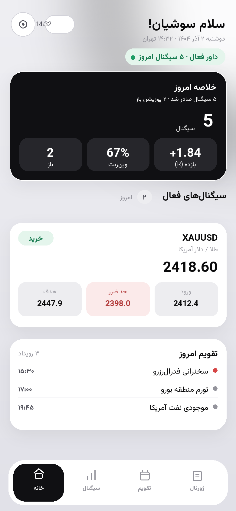
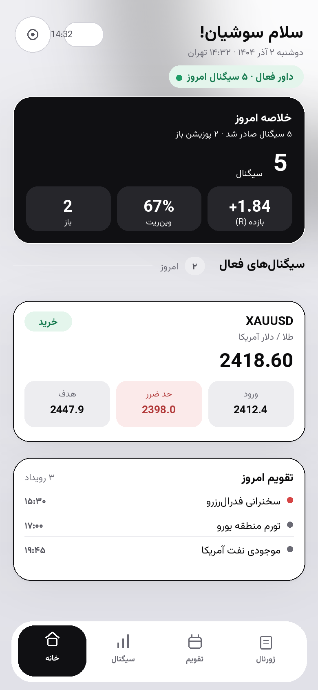

# 🔍 بازبینی UI/UX و ارتقای v1.4.0 — «Aurora Glass 2.1»

> **دامنه:** رابط اندروید (WebView، `android/app/src/main/assets/www/`) و رابط دسکتاپ
> (PySide6، `src/ui/`).
> **قید کار:** پالت رنگ و قالب/چیدمان فعلی حفظ شود؛ هدف «پالایش» است نه «بازطراحی».
> **نتیجه:** صفر توکن رنگِ تازه، صفر صفحهٔ جابه‌جاشده، ۹ اصلاحِ قابل‌اندازه‌گیری.

---

## ۱. روش کار

۱) خواندن کد رابط: `style.css` (۱۱۵۹ خط)، `index.html`، `components.js`، `ui.js`،
   `src/ui/theme.py` (۴۱۷ خط) و `src/ui/widgets.py`.
۲) ثبت وضعیت «قبل» با اسکرین‌شات.
۳) جست‌وجوی الگوهای ۲۰۲۶ و استخراج آن‌هایی که *به این محصول* مربوط‌اند.
۴) اعمال اصلاح‌ها در سطح توکن + جزء، با حفظ پالت و چیدمان.
۵) ثبت وضعیت «بعد» با همان زاویهٔ دوربین.

### دربارهٔ اسکرین‌شات‌ها (مهم)

در محیطِ ساختِ این مستند، نه PySide6 اجرا می‌شود (کتابخانه‌های `libEGL`، `libGL`،
`libdbus-1`، `libxkbcommon` نصب نیستند) و نه موتور WebView/Chromium در دسترس است.
بنابراین تصاویر زیر **رندرِ طراحی** از همان توکن‌های واقعی‌اند، نه عکسِ دستگاه:
`assets/render_ui_preview.py` همان اعداد `style.css`/`theme.py` را می‌خواند و صفحهٔ
خانه را در دو حالت (v1.3.1 و v1.4.0) با فونت واقعیِ Vazirmatn می‌سازد. برای
گرفتن اسکرین‌شاتِ واقعی، اپ را روی دستگاه/شبیه‌ساز نصب کنید؛ ساختار صفحه دقیقاً
همین است.

| قبل (v1.3.1) | بعد (v1.4.0) |
|---|---|
|  |  |

نسخهٔ کنارِ هم: `images/ui-before-after-home.png`.

---

## ۲. تحلیل وضعیت قبل

رابط از v0.21.0 یک سیستم طراحیِ جاافتاده دارد؛ مشکل «کم‌کاری» نبود، «اضافه‌کاری» بود.

**نقاط قوت:** سلسله‌مراتب روشن (کارت مشکیِ لهجه در کنار کارت‌های سفید)، شعاع‌های
بزرگ و منسجم، پیِل تبِ فعال، حالت‌های خالیِ اختصاصی، احترام به `safe-area`،
پشتیبانی از `prefers-reduced-motion` و `:focus-visible`، ارقام tabular.

**مسائل پیدا‌شده (به ترتیب شدت):**

| # | مسئله | شدت | شاهد |
|---|---|---|---|
| ۱ | متن ثانویهٔ سوم زیر حد WCAG AA | بالا | `--text-3: #94949C` روی سفید = **۲٫۹۹:۱** برای متن ۱۱px (حد: ۴٫۵:۱) |
| ۲ | بلورِ زیاد روی سطح‌های اسکرول‌شونده | بالا (کارایی) | `backdrop-filter: blur(10px)` روی هر `.card` + `blur(16px)` نوار تب + `blur(8px)` قرص ساعت |
| ۳ | مرزِ نامرئی + سایهٔ تک‌لایه | متوسط | کارت با `border: 1px solid rgba(255,255,255,.9)` روی زمینهٔ روشن هیچ لبه‌ای نمی‌سازد |
| ۴ | هدف لمسی ۴۰px | متوسط | `.circle-btn` ۴۰×۴۰ (حد توصیه‌شده ۴۴) |
| ۵ | مدت‌های حرکتِ پراکنده | کم | `.12s`, `.18s`, `.22s`, `.3s` دستی در ده‌ها سلکتور |
| ۶ | زیرنویس ۱۰٫۵px | کم | `#appsub`, `.card-sub`, `.hint` |
| ۷ | نبود ریتم در سربرگ بخش‌ها | کم | `.section-title` فقط متن است، بدون خط/شمارش |
| ۸ | سلسله‌مراتب عدد در کارت سیگنال | کم | قیمت ۲۲px هم‌وزن با عنوان ۱۵px در فاصلهٔ کم |
| ۹ | متن روی کارت مشکی ۵۵٪ سفید | کم | `.ink-cap` روی `#101013` ≈ ۵٫۶:۱ — قابل قبول ولی برای ۱۰٫۵px تنگ |

---

## ۳. الگوهای ۲۰۲۶ که مبنا قرار گرفتند

خلاصهٔ منابع بررسی‌شده (DesignStudioUIUX، MindInventory، Vivacity، DigitalAuxilius، VP0):

- **شیشهٔ جراحی / Liquid Glass:** شفافیت فقط برای لایه‌های شناور (هدر، شیت، ناوبری)،
  نه برای همه‌چیز.
- **چیدمان پایین‌محور و در دسترسِ شست:** ناوبری در یک‌سوم پایین، شیت به‌جای FAB شناور.
- **مینیمالیسمِ عامدانه:** سلسله‌مراتبِ کمتر اما قوی‌تر، وضوحِ شناختی بر تزئین.
- **عمقِ نرم و لمسی:** سایه/هایلایتِ ملایم، ارتفاعِ تدریجی، پرهیز از کادرِ سنگین.
- **میکرو‌تعاملِ کارکردی:** حرکت برای بازخورد (فشار، تغییر وضعیت)، نه برای نمایش.
- **دسترس‌پذیری‌محور:** کنتراست WCAG، مقیاس خوانا، هدف لمسی ۴۴–۴۸px.
- **ضدالگوها:** بلور/انیمیشنِ زیاد روی دستگاه ضعیف، نئومورفیسمِ کم‌کنتراست.

مورد سوم و پنجم در این محصول از قبل رعایت شده بود؛ بنابراین کار روی ۱، ۴، ۶ و ۷ متمرکز شد.

---

## ۴. تغییرات اعمال‌شده

همهٔ تغییرات در دو فایلِ منبعِ حقیقت انجام شده: `src/ui/theme.py` و
`android/app/src/main/assets/www/style.css`. پاریتی با `tests/js/smoke_theme_parity.js`
قفل است (۲۲۷ بررسی).

| # | تغییر | جای اثر |
|---|---|---|
| ۱ | `text_3`: `#94949C` → `#6A6A74` (۲٫۹۹:۱ → ۵٫۳:۱) | هر دو فایل، همهٔ زیرنویس‌ها |
| ۲ | `.card/.sig-card/.kpi-card/.console-card`: سطحِ مات + `border: 1px rgba(16,16,19,.045)` + `shadow-soft`، **بدون** `backdrop-filter` | `style.css` بلوک v1.4.0 |
| ۳ | توکن‌های تازه: `shadow_soft`, `shadow_lift`, `motion_fast/base/slow`, `target_min`, `radius_sheet` | هر دو فایل |
| ۴ | `.circle-btn` ۴۰→۴۴px، `.btn.sm/.btn.subtle` ≥ ۴۴px | `style.css` |
| ۵ | زیرنویس‌ها ۱۰٫۵→۱۱px؛ متن روی کارت مشکی ۵۵٪→۶۲٪ | `style.css` |
| ۶ | حرکت یکدست با `var(--motion-*)` + فشارِ `.994` روی کارت‌های قابل‌لمس + بالا آمدن ۱px تب فعال | `style.css` |
| ۷ | خط موییِ امتداد‌یابنده در `.section-title` | `style.css` |
| ۸ | عدد کاشی جوهری ۱۸→۲۰، قیمت سیگنال ۲۲→۲۴، عنوان صفحه ۱۹→۲۰ | `style.css` |
| ۹ | فوکوس ورودی: حلقهٔ نرم `0 0 0 3px rgba(16,16,19,.10)` به‌جای تغییرِ تنها رنگِ مرز | `style.css` |

**چیزهایی که عمداً تغییر نکرد:** پالت (هیچ رنگ تازه‌ای اضافه نشد)، چیدمان صفحه‌ها،
نوار تب، کارت جوهری، شعاع کارت ۲۲، ساختار صفحات، و آیکون‌ها.

---

## ۵. تأیید

```bash
node tests/js/smoke_theme_parity.js     # ۲۲۷ بررسی
node tests/js/smoke_brand_identity.js
.venv/bin/python tests/test_*.py
```

- پاریتی توکن‌ها: ✅
- صفر ایموجی در خروجی اجزا: ✅ (بدون تغییر در `components.js`)
- کاهش حرکت (`prefers-reduced-motion`): ✅ همچنان فعال
- نسخه: `1.4.0`

---

## ۶. قدم‌های بعدی (پیشنهاد، اعمال نشده)

۱) **اسکلتون به‌جای اسپینر** در صفحهٔ سیگنال‌ها هنگام «تحلیل تازه» (حالتِ آرامِ
   بارگذاری؛ کلاس‌های `.sk` لازم است).
۲) **نوار فاصله تا هدف** روی کارت سیگنال — نیازمند قیمت لحظه‌ای در payload.
۳) **شیت کشویی** برای جزئیاتِ سیگنال روی موبایل (الگوی ۲۰۲۶: شیت، نه صفحهٔ جدید).
۴) **حالت تاریکِ کامل** در وب‌ویو (دسکتاپ از v0.20.0 پالت جوهری دارد؛ موبایل ندارد).
